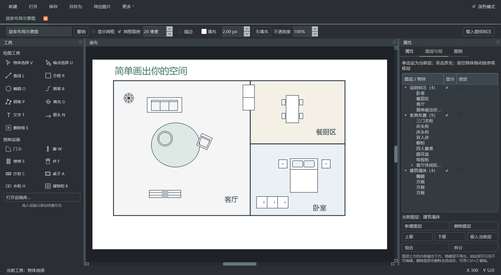
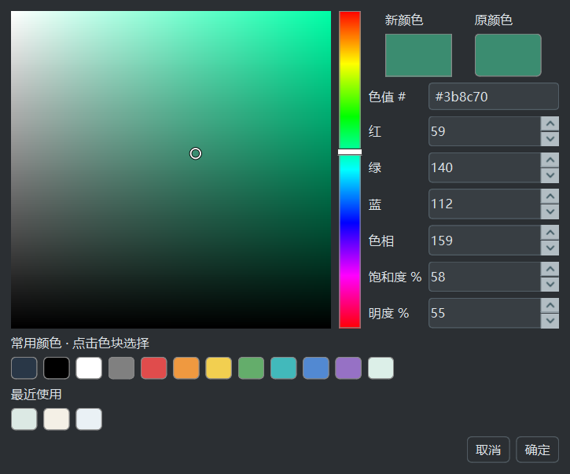

# EasyDrawFlat

一款全中文 Windows 平面图绘制工具，用来画房间布局、摆放家具、添加文字和图例。

**由 gpt6.1sol 制作。**

[下载 1.0 版](https://github.com/AAAjct/EasyDrawFlat/releases/latest) · [直接下载 Windows 程序](https://github.com/AAAjct/EasyDrawFlat/releases/download/v1.0/EasyDrawFlat.exe)



## 1.0 更新

- 「载入图纸标注」放在绘图工具栏最右侧。它与「撤销」「无填充」都有按钮边框。
- 在左侧按住预制设施快捷方式并拖到图纸即可放置。也可以单击快捷方式，再到图纸上单击放置。
- 选中物体后可调整 0–100% 不透明度，支持组合和多选，设置随图纸保存并应用于导出。
- 修复切换图层显示或锁定状态时偶发的崩溃。

## 2.9 更新

- 设施库支持拼音模糊搜索。输入 `c` 或 `chuang` 都能找到名称包含「床」的设施，例如单人床、双人床。也可以输入 `单人 chuang`，或同时使用分类筛选。

## 2.8 更新

- 选中图例并点击「移除库图例」，即可移除包括门、床在内的任意库图例。重启后仍保留移除结果，已加入图纸的图例继续显示。可用「一键添加所有快捷设施」重新录入快捷设施。
- 顶栏「更多」按钮显示一个下拉箭头。

## 2.7 更新

- 修复设施库拖出功能。把设施拖到左侧“预制设施”下方的空白区域即可添加快捷方式。
- “一键添加所有快捷设施”会把所有快捷设施录入本机**图例库**，并跳过重复项。
- “一键添加所有图例至画布”会把**图例库的全部图案**加入画布右上角的图例参考框，包含图案与名称，支持撤销和导出。
- 图例库支持中文、全拼和拼音首字母搜索，例如“沙发”“shafa”“sf”。

## 主要功能

- **椭圆工具**：拖动绘制椭圆，支持填色、描边和缩放。
- **更方便的选色**：参考 PS 的色板和色相条，支持 RGB、色相/饱和度/明度、十六进制色值、常用色和最近用色。
- **图层与组合**：按类别整理物体，图层可改名、排序、隐藏和锁定；按住层内物体拖动，可改变遮挡顺序或移入别的图层。选中多个物体后右键组合，也可拆分；一个组合按一个物体操作。
- **134 种中文设施**：卧室、客厅、餐厨、卫浴、办公教学、建筑构件、公共及室外设施，支持分类和关键词搜索，例如“沙发”“马桶”“消防”。
- **独立设施库窗口**：显示在任务栏，可最小化、最大化、关闭，能够放在一旁继续画图。把图案拖到左侧“预制设施”区域即可添加快捷方式，重启后保留，右键可移除。
- **更简洁、更轻量**：属性、图层与组、图例分开显示。复用画布对象，减少重绘和图标生成；限制撤销快照占用。精简打包时未使用的 Qt 模块，Windows 单文件程序可直接运行。




## 开始使用

1. 在 [Releases](https://github.com/AAAjct/EasyDrawFlat/releases/latest) 下载 `EasyDrawFlat.exe`，双击运行，无需安装 Python。
2. 在左侧选择工具，拖动绘制图形；打开设施库，双击设施后在画布上单击放置。长按再拖动可调整设施大小。
3. 使用右侧“图层与组”整理内容。框选多个物体，右键选择“组合”或“拆分组合”。跨图层组合会归入所选物体中最上方物体所在的图层。
4. 保存为 `.edf`，下次可继续编辑；也可以导出 PNG、JPG 或 SVG。

图层从上往下叠放；隐藏层不导出，锁定层可显示但不能编辑。删除图层会同时删除该层全部物体，误删可用 Ctrl+Z 撤销。删除最后一层后会留下一个空白默认层。设施库快捷方式与最近颜色保存在本机，不影响图纸文件。

图例页可“一键添加所有快捷设施”录入图例库，再用“一键添加所有图例至画布”显示右上角的图例参考框。搜索只筛选图例库下拉列表，不影响批量添加全部图例。图纸会嵌入使用的图例，换一台电脑也能显示。


支持多图纸选项卡、跨图纸复制粘贴、撤销重做、钢笔曲线、锚点编辑、文字标注、图例、网格吸附，以及批量保存和导出。可以把 `.edf` 文件拖到软件窗口或程序图标上打开。

### 常用操作

| 操作 | 快捷键 / 鼠标 |
| --- | --- |
| 选择 / 方框 / 椭圆 | V / R / O |
| 钢笔 / 文字 | P / T |
| 组合 / 拆分 | Ctrl+G / Ctrl+Shift+G |
| 移动、缩放、旋转所选物体 | Ctrl+T，拖动控制框 |
| 撤销 / 重做 | Ctrl+Z / Ctrl+Y |
| 保存 / 打开 / 导出 | Ctrl+S / Ctrl+O / Ctrl+E |
| 复制粘贴 / 直接复制一份 | Ctrl+C、Ctrl+V / Ctrl+D |
| 临时框选 / 右键菜单 | 右键拖动 / 右键单击 |
| 移动物体 / 平移视野 | 中键拖动 / Ctrl+中键拖动 |
| 缩放视野 / 恢复全图 | Ctrl+滚轮 / Ctrl+0 |

更多操作可在软件的“更多 → 快捷键一览”查看。旧版 `.edf` 可直接打开；新增的图层和组合请使用 2.6 或更新版本编辑。

本工具用于布局示意，画布为 1400×900 像素，不是建筑测量或施工制图软件。

## 从源码运行

推荐 Python 3.11 或更新版本。在项目目录执行：

```powershell
python -m pip install -r requirements.txt
python main.py
```

构建 Windows 单文件程序：

```powershell
python -m pip install pyinstaller
python build.py
```

程序生成在 `dist/v1.0/EasyDrawFlat.exe`。运行验证：

```powershell
python -m unittest discover -s tests -v
```

## 项目结构

```text
main.py              界面、绘图、图层、组合和图纸读写
color_picker.py      颜色选择面板
facilities.py        中文设施目录与矢量图案
assets/              界面图标
build.py             Windows 构建入口
windows.spec         精简打包配置
version_info.txt     Windows 版本信息
requirements.txt     源码运行依赖
tests/               功能回归测试与截图脚本
docs/images/         README 软件截图
```

基于 Python、PySide6 和 [pypinyin](https://github.com/mozillazg/python-pinyin) 开发。仓库保留源码、测试和说明图片，Windows 程序在 Releases 下载。
