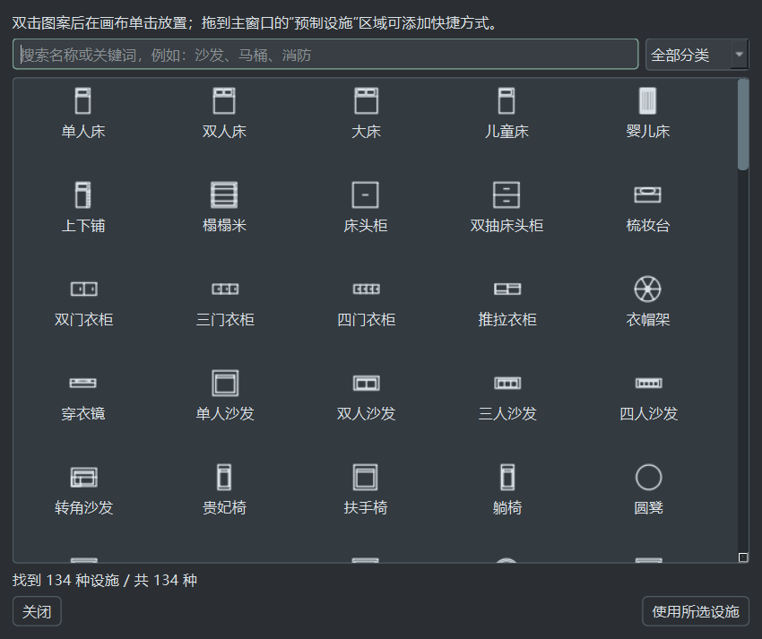
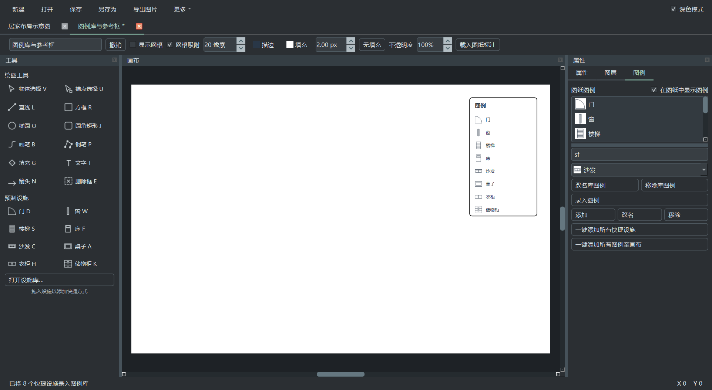

# EasyDrawFlat

EasyDrawFlat 是一款全中文 Windows 平面图绘制工具，适合画房间布局、摆放家具、标记位置和制作图例。

**由 gpt6.1sol 制作。**

[下载 EasyDrawFlat 1.1](https://github.com/AAAjct/EasyDrawFlat/releases/latest) · [直接下载 EXE](https://github.com/AAAjct/EasyDrawFlat/releases/download/v1.1/EasyDrawFlat.exe)


## 1.1 有什么新功能

- **按选择裁剪**。先选中一个或多个物体，按 **E** 再拖出删除框，只裁剪框内属于所选物体的部分。比如矩形 A 和 B 重叠，只选 A 时，B 的线条保持原样。没有选中物体时，会裁剪框内所有可编辑的直线、方框和路径。可用 **Ctrl+Z** 撤销。
- **对象名**。在「属性」里给物体起名，方便在「图层」列表里区分同类物体。对象名随图纸保存，画布标注仍可单独编辑。
- **圆角矩形**。按 **J** 后拖动绘制，支持描边、填充和不透明度。

## 快速上手

1. 下载并双击 `EasyDrawFlat.exe`。Windows x64 无需安装 Python。
2. 从左侧选择绘图工具。可画直线、方框、圆角矩形、椭圆、箭头和钢笔曲线，也能添加文字标注。
3. 打开设施库，搜索家具或建筑部件，双击条目后在图纸上单击放置。也可以把常用条目拖到左侧「预制设施」下方添加快捷方式，再把快捷方式拖进图纸。
4. 用右侧「图层」整理物体。可以拖动条目调整遮挡顺序或移到其他图层，也可以右键组合与拆分。锁定图层仍可显示，隐藏图层不进入导出图片。
5. 保存为 `.edf` 便于继续编辑，也可以导出 PNG、JPG 或 SVG。支持同时打开多张图纸、跨图纸复制粘贴和批量导出。

## 配色、设施与图例

- **配色**。描边和填充支持色板、色相、RGB、十六进制色值和最近用色。选中物体或组合后，可调整 0–100% 不透明度。
- **设施库**。内置 134 种中文设施，支持分类、中文、全拼和首字母模糊搜索。例如输入 `chuang` 能找到双人床。设施库可以独立显示，快捷方式在重启后保留。
- **图例库**。可以录入自定义图例，也可一键录入所有快捷设施。支持中文和拼音搜索，内置条目也可移除。「一键添加所有图例至画布」会将库中的条目加入右上角参考框。图纸会保存所用图例。






## 常用操作

| 操作 | 快捷键或鼠标 |
| --- | --- |
| 选择 / 删除框 | V / E |
| 方框 / 圆角矩形 / 椭圆 | R / J / O |
| 钢笔 / 文字 | P / T |
| 组合 / 拆分 | Ctrl+G / Ctrl+Shift+G |
| 移动、缩放、旋转所选物体 | Ctrl+T 后拖动控制框 |
| 撤销 / 重做 | Ctrl+Z / Ctrl+Y |
| 保存 / 打开 / 导出 | Ctrl+S / Ctrl+O / Ctrl+E |
| 临时框选 / 打开右键菜单 | 右键拖动 / 右键单击 |
| 平移视野 / 缩放视野 | Ctrl+中键拖动 / Ctrl+滚轮 |

完整快捷键可在「更多 → 快捷键一览」查看。图纸采用 1400×900 像素画布，用于布局示意。

## 从源码运行与打包

使用 Python 3.11 或更新版本。在项目目录运行：

```powershell
python -m pip install -r requirements.txt
python main.py
```

构建 Windows 单文件程序并运行测试：

```powershell
python -m pip install pyinstaller
python build.py
python -m unittest discover -s tests -v
```

EXE 生成在 `dist/v1.1/EasyDrawFlat.exe`。主要代码在 `main.py`，设施库和选色器分别在 `facilities.py` 和 `color_picker.py`，界面截图在 `docs/images/`。
